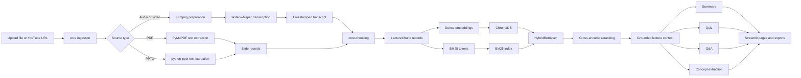
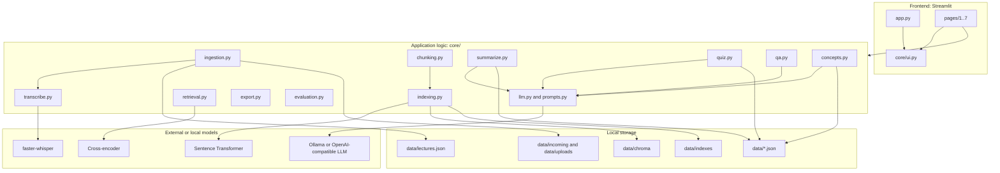
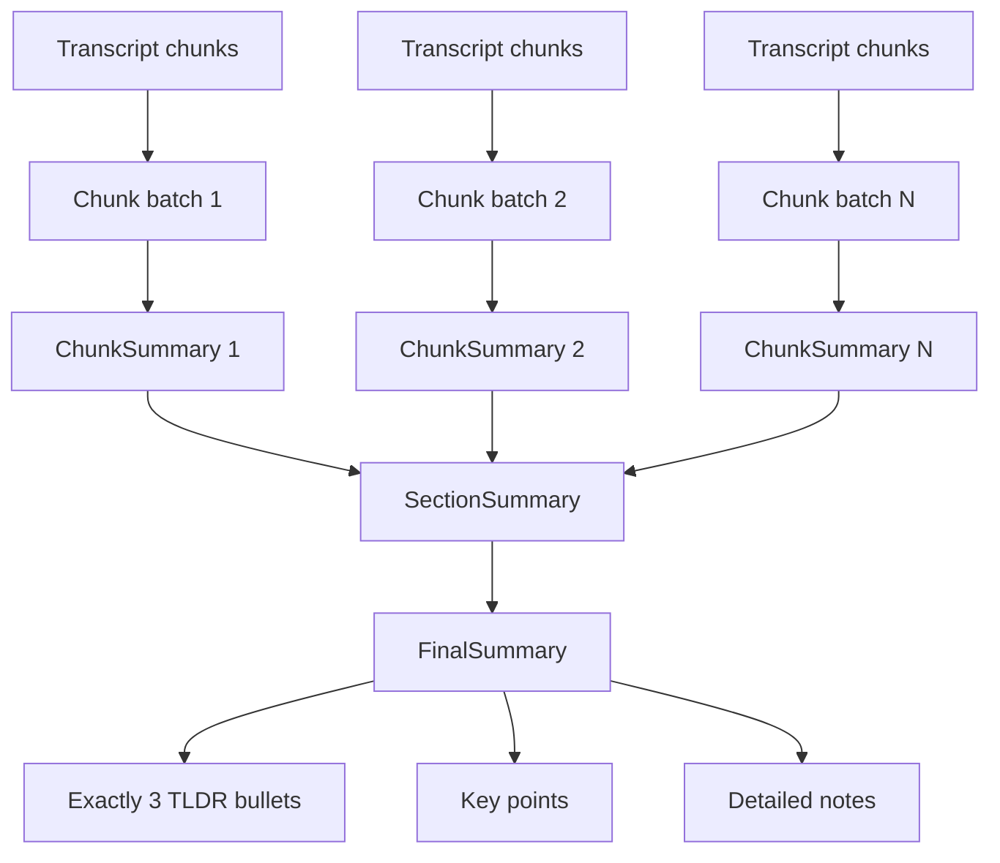
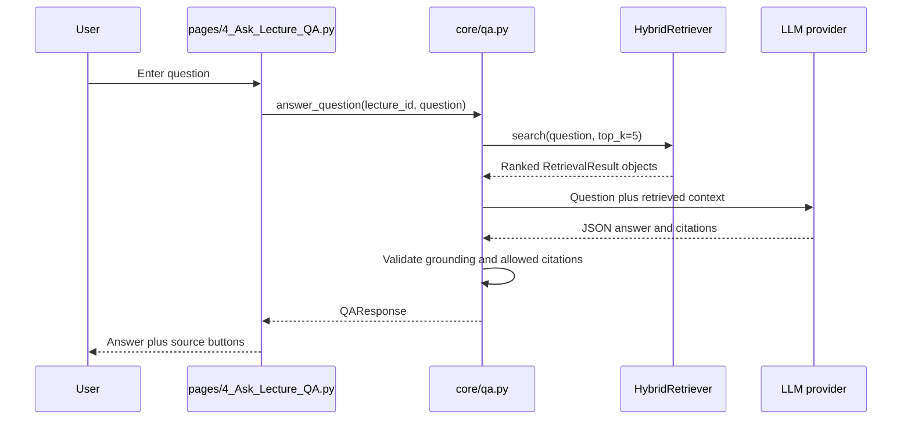
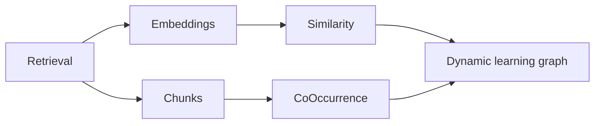

# Lecture Workbench — Project Documentation

Lecture Workbench is a local Streamlit application that turns lecture media and
documents into searchable study material. It combines speech-to-text, document
extraction, hybrid retrieval, large language model (LLM) generation, schema
validation, and source navigation.

> **Implementation note:** This document describes the code currently present in
> this repository. Where the original synopsis describes behavior that is not
> implemented, it is explicitly listed under [Limitations / Future Work](#15-limitations--future-work).

## Table of Contents

1. [Project Overview](#1-project-overview)
2. [System Architecture](#2-system-architecture)
3. [Technology Stack](#3-technology-stack)
4. [End-to-End Workflow](#4-end-to-end-workflow)
5. [How Video Content Is Summarized](#5-how-video-content-is-summarized)
6. [RAG Explained](#6-rag-explained)
7. [Quiz Generation and Validation](#7-quiz-generation-and-validation)
8. [Q&A with Citations](#8-qa-with-citations)
9. [Dynamic Learning Graph](#9-dynamic-learning-graph)
10. [Frontend Guide](#10-frontend-guide)
11. [Data and Storage](#11-data-and-storage)
12. [Configuration and Setup (Windows 11)](#12-configuration-and-setup-windows-11)
13. [Evaluation](#13-evaluation)
14. [Performance Notes](#14-performance-notes)
15. [Limitations / Future Work](#15-limitations--future-work)
16. [Viva Preparation](#16-viva-preparation)
17. [Glossary](#17-glossary)
18. [Verification Checklist](#18-verification-checklist)

---

## 1. Project Overview

### Title

**Lecture Workbench: RAG-Based Smart Lecture Summarizer and Adaptive Quiz System**

### Problem statement

Long lectures are difficult to review because useful explanations are buried in
hours of audio, video, slides, or notes. A learner needs more than a transcript:
they need concise explanations, searchable evidence, practice questions, and a
way to return to the exact part of the lecture that supports an answer.

### Motivation

The project reduces the time between attending a lecture and revising it. It
keeps generated material tied to the original lecture through timestamps or
slide numbers, so a learner can inspect the source instead of trusting an
unsupported generated statement.

### Objectives

- Accept local audio/video, PDF, PPTX, and YouTube sources.
- Convert audio/video into timestamped text.
- Extract text from PDF and PowerPoint slides.
- Divide source text into searchable chunks.
- Build keyword and semantic indexes.
- Generate structured summaries with source references.
- Generate and validate lecture-grounded quizzes.
- Answer questions using retrieved lecture context.
- Extract concepts and build an interactive learning graph.
- Export summaries and quizzes.
- Measure retrieval-answer quality with RAGAS.

### Scope in

- Local Streamlit user interface.
- Local JSON registry and generated artifacts.
- Ollama or OpenAI-compatible LLM generation.
- Whisper-based transcription.
- ChromaDB and BM25 hybrid search.
- Source citations for summary, quiz, Q&A, and concept features.

### Scope out

- Multi-user authentication and authorization.
- Cloud deployment configuration.
- A server API or database-backed multi-user service.
- Training or fine-tuning a language model.
- Automatic lecture topic classification.
- Persistent resumable transcription checkpoints.
- Automatic browser testing at every screen size.

### Target users

- College students revising lectures.
- Teachers preparing study material.
- Project evaluators examining grounded generation.
- Developers learning how a small retrieval-augmented generation system works.

### What makes it unique

The project combines a **Dynamic Learning Graph** with grounded citations. The
graph connects concepts using lecture co-occurrence and embedding similarity,
while summaries, quiz questions, Q&A answers, and concepts retain timestamps or
slide references. The result is not only generated study material; it is
material that can be traced back to the source lecture.

---

## 2. System Architecture

### Full processing pipeline



### Layered architecture



### Folder structure

```text
COLLEGE PROJECT/
├── app.py                         Landing page and Streamlit entry point
├── requirements.txt               Python dependency ranges
├── .env.example                   Environment-variable template
├── .env                            Local environment values; should not be committed
├── .gitignore                      Ignore rules for secrets, caches, and generated data
├── package-lock.json               Node package-lock file present in the workspace
├── pytest.ini                      Pytest marker configuration
├── .streamlit/config.toml         Streamlit theme and server configuration
├── README.md                      Existing setup and architecture notes
├── PROJECT_DOCUMENTATION.md       This detailed implementation guide
├── core/
│   ├── __init__.py                Core package marker
│   ├── ingestion.py               Source validation, copying, downloading, extraction, registry
│   ├── transcribe.py              FFmpeg preparation and faster-whisper transcription
│   ├── chunking.py                Transcript/page chunk data model and chunk builders
│   ├── indexing.py                Embeddings, ChromaDB, and BM25 index persistence
│   ├── retrieval.py               BM25, dense search, reciprocal-rank fusion, reranking
│   ├── llm.py                     Ollama/OpenAI-compatible LLM client
│   ├── prompts.py                 Prompt templates for summaries, quizzes, Q&A, concepts
│   ├── summarize.py               Hierarchical summary schemas, parsing, caching, generation
│   ├── quiz.py                    Quiz schemas, generation, verification, grading, caching
│   ├── qa.py                      Grounded answer schema, retrieval context, citation checks
│   ├── concepts.py                Concept extraction, caching, and NetworkX graph construction
│   ├── export.py                  Markdown, PDF, CSV, and Anki export functions
│   ├── evaluation.py              RAGAS record creation and evaluation
│   └── ui.py                      Shared styling, navigation, selectors, cards, source controls
├── pages/
│   ├── 1_Upload_and_Process.py    Upload cards, processing progress, retry, active lecture
│   ├── 2_Lecture_Player.py        Media player, transcript, summary, source navigation
│   ├── 3_Quiz.py                  Quiz controls, questions, scoring, weak concepts
│   ├── 4_Ask_Lecture_QA.py        Grounded chat and citations
│   ├── 5_Concept_Graph.py         Graph, concept detail, mini-quiz, concept Q&A
│   ├── 6_Export.py                Summary and quiz downloads
│   └── 7_Evaluation.py            Evaluation setup, metrics, chart, detailed rows
└── tests/
    ├── __init__.py                Test package marker
    ├── test_chunking.py           Chunk timestamp metadata test
    ├── test_concepts.py           Concept schema and graph tests
    ├── test_export_evaluation.py  Export and evaluation-record tests
    ├── test_llm.py                Optional Ollama integration smoke test
    ├── test_qa.py                 Q&A schema and context tests
    ├── test_quiz.py               Quiz schema and grading tests
    ├── test_retrieval.py           Reciprocal-rank fusion test
    └── test_summary.py            Summary schema and prompt tests
```

Generated files under `data/`, Python bytecode under `__pycache__/`, and
`.pytest_cache/` are runtime artifacts rather than application source files.

---

## 3. Technology Stack

The versions below are the ranges declared in `requirements.txt`, not a claim
that every package is installed at the maximum version.

| Tool / library | Version from requirements | Purpose | Why chosen | Where used |
|---|---:|---|---|---|
| Streamlit | `>=1.39,<2` | Web UI and multipage application | Fast Python UI for an academic prototype | `app.py`, `pages/`, `core/ui.py` |
| python-dotenv | `>=1.0,<2` | Loads `.env` settings | Keeps provider/model settings outside code | `core/llm.py`, `core/ingestion.py` |
| httpx | `>=0.27,<1` | HTTP requests | Lightweight provider and test HTTP client | `core/llm.py`, `tests/test_llm.py` |
| openai | `>=1.50,<2` | OpenAI client | Optional hosted OpenAI-compatible generation | `core/llm.py` |
| pydantic | `>=2.8,<3` | Runtime data validation | Enforces structured JSON contracts | `core/*.py` |
| faster-whisper | `>=1.1,<2` | Speech-to-text | Produces timestamped transcription | `core/transcribe.py` |
| FFmpeg | External executable | Audio/video decoding and conversion | Handles many media formats reliably | `core/transcribe.py` |
| PyMuPDF | `>=1.24,<2` | PDF extraction | Direct page text extraction | `core/ingestion.py` |
| python-pptx | `>=1.0,<2` | PowerPoint extraction | Reads slide text without converting slides | `core/ingestion.py` |
| yt-dlp | `>=2024.10,<2026` | YouTube download | Supports many video/audio sources | `core/ingestion.py` |
| chromadb | `>=0.5,<1` | Persistent vector database | Stores dense chunk embeddings locally | `core/indexing.py`, `core/retrieval.py` |
| sentence-transformers | `>=3.0,<6` | Embeddings and cross-encoder | Provides semantic representations and reranking | `core/indexing.py`, `core/retrieval.py` |
| transformers | `>=4.49,<4.50` | Embedding/reranker fallback | Used when sentence-transformers loading fails | `core/indexing.py`, `core/retrieval.py` |
| rank-bm25 | `>=0.2,<1` | Keyword retrieval | Fast lexical search over chunk tokens | `core/retrieval.py` |
| networkx | `>=3.3,<4` | Graph construction | Simple in-memory concept graph operations | `core/concepts.py` |
| streamlit-agraph | `>=0.0.45,<1` | Graph visualization | Interactive graph component | `pages/5_Concept_Graph.py` |
| fpdf2 | `>=2.7,<3` | PDF export | Creates downloadable study PDFs | `core/export.py` |
| genanki | `>=0.13,<1` | Anki export | Creates `.apkg` decks when available | `core/export.py` |
| ragas | `>=0.2,<1` | RAG evaluation | Calculates faithfulness and context metrics | `core/evaluation.py` |
| datasets | `>=2.20,<4` | Evaluation dataset | Supplies the dataset passed to RAGAS | `core/evaluation.py` |

### FFmpeg

FFmpeg is a command-line multimedia toolkit. This project uses it in
`prepare_audio_segments()` to convert a source into mono 16 kHz PCM WAV
segments before Whisper reads them. FFmpeg is not installed by
`requirements.txt`; it must be installed on Windows and available on `PATH`.

### Ollama

Ollama is a local model-serving application. When `LLM_PROVIDER=ollama`,
`LLMClient._complete_ollama()` sends chat messages to
`OLLAMA_BASE_URL/api/chat`. The default model is `llama3`. Ollama is optional
in the sense that `core/llm.py` also supports the OpenAI client when
`LLM_PROVIDER=openai`.

---

## 4. End-to-End Workflow

### 4.1 Ingestion

| Item | Implementation |
|---|---|
| Input | `Path` for a local file or `str` YouTube URL |
| Process | `ingest_source()` validates the source, fingerprints it, copies/downloads it, and creates a registry record |
| Output | Lecture record with `lecture_id`, title, source type, status, and paths |
| Tools | `pathlib`, `hashlib`, `yt_dlp`, `shutil` |
| Function/file | `core.ingestion.ingest_source()` |

Example record:

```json
{
  "lecture_id": "abc123",
  "title": "Operating Systems",
  "source_type": "mp3",
  "status": "processing",
  "created_at": "2026-10-25T00:00:00+00:00",
  "transcript_path": null,
  "pages_path": null
}
```

### 4.2 Audio extraction

`prepare_audio_segments()` invokes FFmpeg with `-vn`, `-ac 1`, `-ar 16000`,
and PCM output. The default segment length is read from
`WHISPER_SEGMENT_SECONDS`, defaulting to `600`.

Example internal command shape:

```text
ffmpeg -y -i source.mp4 -vn -ac 1 -ar 16000 -c:a pcm_s16le
  -f segment -segment_time 600 -reset_timestamps 1 segment-%05d.wav
```

### 4.3 Transcription

`transcribe_media()` loads a cached Whisper model, transcribes each WAV segment,
adds the segment offset, and writes a list of transcript records.

```json
[
  {
    "start": 12.4,
    "end": 18.2,
    "text": "A repository stores the history of a project."
  }
]
```

### 4.4 Slide parsing

`extract_document_text()` dispatches to `_extract_pdf()` or `_extract_pptx()`.

```json
[
  {
    "slide_no": 2,
    "text": "A commit records a snapshot of project changes."
  }
]
```

### 4.5 Chunking and metadata

`chunk_transcript()` and `chunk_pages()` create `LectureChunk` objects.
Transcript defaults are `target_words=320` and `overlap_words=45`.
Page chunks use the same defaults. Transcript chunks carry `start_time` and
`end_time`; page chunks carry `slide_no`.

```json
{
  "chunk_id": "abc123-chunk-00000",
  "lecture_id": "abc123",
  "text": "A repository stores ...",
  "start_time": 0.0,
  "end_time": 42.0,
  "slide_no": null
}
```

### 4.6 Embeddings and indexing

`index_lecture()` writes chunk JSON, generates normalized embeddings with the
configured embedding model, upserts them into a Chroma collection, and writes
lowercase token lists for BM25.

```json
{
  "lecture_id": "abc123",
  "chunk_count": 18,
  "collection": "lecture_abc123"
}
```

### 4.7 Hybrid retrieval and reranking

`HybridRetriever.search(query, top_k=5)` obtains BM25 and dense candidate
rankings, fuses them, scores candidates with the cross-encoder, and returns up
to five `RetrievalResult` objects.

### 4.8 Summarization

`summarize_lecture()` batches chunks, creates `ChunkSummary` objects, creates a
`SectionSummary`, then creates a `FinalSummary`. It caches the final result in
`data/<lecture_id>.summary.json`.

Unlike Q&A, the current summary implementation does not call
`HybridRetriever`; it summarizes the chunks returned by
`chunks_for_lecture(lecture)` in lecture order.

### 4.9 Quiz generation

`generate_quiz()` loads cached chunks, asks the LLM for exactly the requested
number of questions, validates the `QuizSet`, runs `_verify_questions()` for
selectable questions, and caches the quiz JSON.

### 4.10 Q&A

`answer_question()` retrieves lecture chunks, constructs a context with allowed
source references, asks the LLM for a `QAResponse`, and rejects citations that
were not present in retrieved context.

### 4.11 Concept extraction and graph

`extract_concepts()` asks for 5–30 concepts and caches a `ConceptSet`.
`build_concept_graph()` creates a NetworkX graph and adds co-occurrence and
embedding-similarity edges.

### 4.12 Export

`summary_to_markdown()`, `summary_to_pdf()`, `quiz_to_csv()`, and
`quiz_to_anki()` convert validated models to downloadable data.

### 4.13 Evaluation

`records_from_quiz()` creates `EvaluationRecord` objects from quiz questions and
indexed chunks. `evaluate_with_ragas()` passes those records to RAGAS and
normalizes the result into `EvaluationResult`.

---

## 5. How Video Content Is Summarized

### 5.1 Video becomes text

1. The user uploads a media file in `pages/1_Upload_and_Process.py`.
2. `ingest_source()` copies it to `data/uploads/<lecture_id>.<suffix>`.
3. `transcribe_media()` calls `prepare_audio_segments()`.
4. FFmpeg creates mono, 16 kHz WAV segments.
5. `get_whisper_model()` loads `WHISPER_MODEL_SIZE`, default `base`.
6. Each segment is transcribed with `vad_filter=True` and
   `beam_size=WHISPER_BEAM_SIZE` or `1` if unset.
7. Segment-relative timestamps are shifted by the segment offset.
8. The transcript is saved as JSON.

The transcript timestamp is the first grounding layer. It allows a summary
statement to point back to a time in the original recording.

### 5.2 Chunking details

`chunk_transcript()` first removes empty segments. It accumulates words until
the current count reaches the target of 320 words and either:

- the latest text ends with `.`, `?`, `!`, or `:`, or
- there is a gap of at least 1.5 seconds between adjacent segments.

This is a lightweight natural-boundary rule. It is not a machine-learned topic
segmentation algorithm.

When a chunk is emitted, the last 45 words of the chunk are retained as overlap
for the next chunk. This helps preserve context across chunk boundaries.

The actual fields are:

| Field | Meaning |
|---|---|
| `chunk_id` | Stable ID such as `abc123-chunk-00000` |
| `lecture_id` | Parent lecture |
| `text` | Joined source text |
| `start_time` | First transcript start, or `null` for page chunks |
| `end_time` | Last transcript end, or `null` for page chunks |
| `slide_no` | First page/slide number, or `null` for transcripts |

### 5.3 Hierarchical summarization

`_batch_chunks()` groups chunks into batches of at most approximately 2,800
words. This keeps each intermediate LLM request bounded rather than sending the
whole lecture in one request.

The tree is:



The three final tiers are:

- **TL;DR:** exactly three concise `SummaryBullet` objects.
- **Key Points:** important concise claims.
- **Detailed Notes:** fuller but still concise notes.

Each `SummaryBullet` has `text` and a `SourceReference`. A
`SourceReference.timestamp` must match `^\d{2}:\d{2}$`; `slide` is optional.

### 5.4 Exact prompt templates

The following templates are copied from `core/prompts.py`. The runtime injects
the context into each f-string.

#### Chunk summary prompt

```python
return f"""Summarize these lecture excerpts into JSON with this exact shape:
{{"summary": "one concise paragraph in plain words", "points": [{{"text": "claim in plain words", "source_reference": {{"timestamp": "00:00", "slide": null}}}}]}}
Use 2-5 points. Replace 00:00 with an actual timestamp copied from the lecture context. Never output the literal placeholder 00:00, MM:SS, or any made-up timestamp. Write the summary as readable sentences, not JSON text inside the claim.

LECTURE CONTEXT:
{context}"""
```

#### Section summary prompt

```python
return f"""Combine these chunk summaries into one coherent section JSON:
{{"title": "short section title", "summary": "concise section summary in plain words", "points": [{{"text": "claim in plain words", "source_reference": {{"timestamp": "00:00", "slide": null}}}}]}}
Use only the supplied summaries and retain their actual source references. Never output the literal placeholder 00:00 or MM:SS.

CHUNK SUMMARIES:
{context}"""
```

#### Final summary prompt

```python
return f"""Create the final lecture summary as JSON with exactly this shape:
{{"tldr": [{{"text": "line in plain words", "source_reference": {{"timestamp": "00:00", "slide": null}}}}], "key_points": [{{"text": "point in plain words", "source_reference": {{"timestamp": "00:00", "slide": null}}}}], "detailed_notes": [{{"text": "note in plain words", "source_reference": {{"timestamp": "00:00", "slide": null}}}}]}}
The tldr must contain exactly 3 lines. Make key_points and detailed_notes complete but concise, using readable sentences.
Every item must cite an actual supplied timestamp and optional slide. Never output 00:00, MM:SS, or a made-up citation. Use only the section summaries.

SECTION SUMMARIES:
{context}"""
```

The `00:00` value is an example placeholder in the schema. The instructions
explicitly tell the model to replace it with a real supplied reference.
`_complete_json()` parses the response, validates it with Pydantic, and retries
up to three attempts using `retry_json_prompt()` when parsing or validation
fails.

### 5.5 Citation production and “not in lecture”

The summarizer does not invent citation objects after generation. The LLM must
copy source references from the context, and Pydantic validates the timestamp
shape. The Q&A path has the strongest explicit grounding check: it builds an
`allowed` set from retrieved results and rejects returned citations outside that
set.

The Q&A system prompt says:

```text
If the answer is not supported, answer exactly 'not in lecture', set grounded to false,
and return an empty citations list.
```

`QAResponse.validate_grounding()` also enforces:

- Ungrounded answers cannot have citations.
- Grounded answers must have at least one citation.

### 5.6 Worked example

Input transcript:

```json
[
  {"start": 0, "end": 4, "text": "A repository stores project history."},
  {"start": 5, "end": 10, "text": "A commit records a snapshot of changes."}
]
```

Chunk:

```json
{
  "chunk_id": "demo-chunk-00000",
  "lecture_id": "demo",
  "text": "A repository stores project history. A commit records a snapshot of changes.",
  "start_time": 0.0,
  "end_time": 10.0,
  "slide_no": null
}
```

Intermediate chunk summary:

```json
{
  "summary": "The lecture explains that repositories preserve project history and commits record changes.",
  "points": [
    {
      "text": "A repository stores project history.",
      "source_reference": {"timestamp": "00:00", "slide": null}
    },
    {
      "text": "A commit records a snapshot of changes.",
      "source_reference": {"timestamp": "00:05", "slide": null}
    }
  ]
}
```

Final summary:

```json
{
  "tldr": [
    {"text": "Repositories preserve project history.", "source_reference": {"timestamp": "00:00", "slide": null}},
    {"text": "Commits record project changes.", "source_reference": {"timestamp": "00:05", "slide": null}},
    {"text": "The two ideas work together for version control.", "source_reference": {"timestamp": "00:05", "slide": null}}
  ],
  "key_points": [
    {"text": "A repository stores the history of a project.", "source_reference": {"timestamp": "00:00", "slide": null}}
  ],
  "detailed_notes": [
    {"text": "A commit is a saved snapshot that lets a learner inspect project changes over time.", "source_reference": {"timestamp": "00:05", "slide": null}}
  ]
}
```

The example is illustrative; actual output depends on the configured LLM and
the supplied lecture context.

---

## 6. RAG Explained

### What RAG means

**Retrieval-Augmented Generation (RAG)** retrieves relevant source passages
before asking an LLM to generate an answer. This reduces hallucination because
the model is given focused lecture evidence rather than being asked to answer
from general model memory alone.

### Retrieval in this project

`HybridRetriever.search()` uses:

1. BM25 lexical search.
2. Dense embedding search through ChromaDB.
3. Reciprocal Rank Fusion (RRF).
4. Cross-encoder reranking.

The default public Q&A call uses `top_k=5`:

```python
def answer_question(
    lecture_id: str,
    question: str,
    *,
    top_k: int = 5,
    client: LLMClient | None = None,
) -> QAResponse:
```

The retriever considers `candidate_limit = max(top_k * 4, 20)`, then returns
the top `top_k` after reranking.

### BM25

BM25 is a keyword-ranking method. The project lowercases and splits chunk text
into tokens, then ranks chunks for the query.

### Dense vectors

The embedding model converts text into numerical vectors. Similar meanings
should produce vectors that are close under cosine similarity. ChromaDB stores
and queries those vectors.

### Reciprocal Rank Fusion

For each ranking list, an item at rank `r` receives:

\[
\mathrm{score}(d) = \sum_{L \in lists} \frac{1}{k + r_L(d)}
\]

The implementation in `core/retrieval.py` is:

```python
scores: dict[str, float] = {}
for ranking in rankings:
    for rank, item_id in enumerate(ranking, start=1):
        scores[item_id] = scores.get(item_id, 0.0) + 1.0 / (k + rank)
return sorted(scores.items(), key=lambda item: (-item[1], item[0]))
```

The default RRF parameter is `k=60` in
`reciprocal_rank_fusion(rankings, *, k=60)`.

### Cross-encoder reranking

A cross-encoder reads the query and candidate document together and assigns a
relevance score. The candidates are sorted by those scores, and only the
highest-ranked results are returned.

---

## 7. Quiz Generation and Validation

### Supported question types

`QuestionType` permits:

- `mcq`
- `true_false`
- `fill_blank`
- `open_ended`

Difficulty is one of `easy`, `medium`, or `hard`. Bloom levels are:

`Remember`, `Understand`, `Apply`, `Analyze`, `Evaluate`, and `Create`.

### Pydantic schema

`QuizQuestion` contains:

```python
question: str
type: QuestionType
options: list[str]
correct_answer: str
bloom_level: BloomLevel
difficulty: Difficulty
explanation: str
source_reference: SourceReference
concept: str
```

Validation rules include:

- MCQ: exactly four options.
- True/false: exactly `["True", "False"]`.
- Fill-in and open-ended: empty options.
- Selectable question answer: must be one of its options.

### Generation and second-pass verification

`generate_quiz()`:

1. Validates that count is between 1 and 20.
2. Loads indexed chunks.
3. Builds a lecture context with source metadata.
4. Calls `quiz_generation_prompt()`.
5. Parses and validates `QuizSet`.
6. Checks that the exact requested number of questions was returned.
7. Calls `_verify_questions()` for MCQ and true/false questions.
8. Saves the quiz JSON.

The second pass uses `quiz_verification_prompt()` and checks that each
selectable question has exactly one valid answer and that the verified correct
option matches the generated answer.

Invalid JSON or validation errors are retried up to three times through
`_complete_json()`. A failed final attempt raises `QuizError`.

### Distractors

The prompt asks the LLM to create plausible distractors contradicted by or
absent from the lecture. The code validates the number and answer shape, but it
does not independently prove that every distractor is pedagogically plausible.

### Adaptive mechanism

After submission, `pages/3_Quiz.py` stores missed question concepts in
`quiz_weak_concepts`. Future calls pass those concepts to
`quiz_generation_prompt()` as a focus list when supported by the context.

### Sample quiz JSON

```json
{
  "questions": [
    {
      "question": "What does a repository store?",
      "type": "mcq",
      "options": [
        "Project history",
        "Only the final executable",
        "A random password",
        "A video player"
      ],
      "correct_answer": "Project history",
      "bloom_level": "Understand",
      "difficulty": "easy",
      "explanation": "The lecture states that a repository stores project history.",
      "source_reference": {"timestamp": "00:12", "slide": null},
      "concept": "repository"
    }
  ]
}
```

---

## 8. Q&A with Citations

The Q&A flow is:



`_context()` formats each retrieved result with a timestamp and slide number and
builds an `allowed` set. `_answer_with_retries()` verifies that returned
citations are a subset of that set.

When a citation button is clicked, `source_chip()` converts `MM:SS` to seconds
and stores it in `st.session_state["player_time"]`. Pages use that value as the
`start_time` for media playback and to highlight a nearby transcript segment.

---

## 9. Dynamic Learning Graph

### Concept extraction

`extract_concepts()` requests between 5 and 30 concepts. Each `Concept` has:

- `name`
- `definition`
- `first_mention_timestamp`
- `slide_no`
- `related_concepts`

Concept JSON is cached at `data/<lecture_id>.concepts.json`.

### Nodes and edges

`build_concept_graph()` creates a NetworkX undirected graph.

- Every extracted concept becomes a node.
- If two concepts occur in the same chunk, a co-occurrence edge is created.
- Repeated co-occurrence increases the edge weight.
- Embedding similarity adds or strengthens edges when similarity is at least
  `0.55`.
- Edge relations are labelled `co-occurrence`, `embedding similarity`, or
  `co-occurrence + similarity`.

The embedding similarity is calculated as a dot product after normalized
embeddings are requested.

### Clicking a concept

The page shows the selected concept definition, first mention, slide, related
concepts, a Watch source button, a three-question mini-quiz, and a
concept-specific Q&A input. The interactive visualization uses
`streamlit_agraph`; an import failure shows a searchable list fallback.



---

## 10. Frontend Guide

### Shared UI: `core/ui.py`

Important helpers include:

| Function | Purpose |
|---|---|
| `setup_page()` | Calls `st.set_page_config()` and injects the shared style |
| `configure_page()` | Backward-compatible alias for `setup_page()` |
| `ready_lectures()` | Returns ready indexed lectures sorted newest first |
| `lecture_selector()` | Selects and remembers `ui_active_lecture_id` |
| `lecture_strip()` | Displays lecture title, source type, readiness, and chunk count |
| `empty_state()` | Displays an empty state and optional navigation button |
| `stage_tracker()` | Renders pending/active/done/failed processing stages |
| `source_chip()` | Real Streamlit timestamp/slide navigation button |
| `stat_card()` | Displays a metric-style card |
| `callout()` | Displays a success, warning, error, or information message |
| `badge()` | Displays a small metadata chip |
| `fmt_ts()` | Converts seconds into `MM:SS` |

The CSS uses the configured paper, card, sidebar, coral, and teal palette. The
sidebar includes grouped navigation and a Lecture Library.

### Landing page: `app.py`

Shows the tagline, five workflow steps, the active lecture when available, and
the Upload or Lecture Player action.

### Upload page: `pages/1_Upload_and_Process.py`

Calls `ingest_source()` and `index_lecture()`. It displays file/YouTube cards,
source validation, progress callbacks, success metrics, and retry handling.
The sidebar Lecture Library shows records from `data/lectures.json`.

### Lecture Player: `pages/2_Lecture_Player.py`

Calls `load_summary()` and, when requested, `summarize_lecture()`. It loads a
transcript JSON file, displays audio/video with `start_time`, renders timestamp
buttons, and displays the three summary tiers.

### Quiz: `pages/3_Quiz.py`

Calls `generate_quiz()`, `load_quiz()`, and `answer_is_correct()`. It stores:

- `active_quiz`
- `quiz_answers`
- `quiz_result`
- `quiz_weak_concepts`

### Ask Lecture: `pages/4_Ask_Lecture_QA.py`

Calls `answer_question()`, stores messages in `qa_messages`, and renders
citations with source buttons.

### Concept Graph: `pages/5_Concept_Graph.py`

Calls `load_concepts()`, `extract_concepts()`, `build_concept_graph()`,
`generate_quiz()`, and `answer_question()`. It stores the mini-quiz in
`concept_mini_quiz`.

### Export: `pages/6_Export.py`

Calls summary and quiz export helpers. It disables the practical workflow by
showing prerequisite empty states when no summary or quiz exists.

### Evaluation: `pages/7_Evaluation.py`

Calls `records_from_quiz()` and `evaluate_with_ragas()`. It stores:

- `evaluation_records`
- `evaluation_result`

### Caching

The application uses Python `functools.lru_cache` for model loading:

- `core.indexing.get_embedding_model()` uses `@lru_cache(maxsize=1)`.
- `core.retrieval.get_reranker()` uses `@lru_cache(maxsize=1)`.
- `core.transcribe.get_whisper_model()` uses `@lru_cache(maxsize=2)`.

There is no `st.cache_resource` decorator in the current code. Generated
artifacts are cached by files and lecture fingerprints instead.

---

## 11. Data and Storage

### Registry

`data/lectures.json` is the persistent lecture registry. `load_lectures()`
creates the file if necessary, validates that it contains a JSON object, and
returns the records. `save_lectures()` writes through a temporary file and
replaces the registry atomically.

### Source directories

| Location | Contents |
|---|---|
| `data/incoming/` | Uploaded source files before processing |
| `data/uploads/` | Copied/downloaded media and extracted page JSON |
| `data/indexes/` | `<lecture_id>.chunks.json` and `.bm25.json` |
| `data/chroma/` | Persistent ChromaDB files |
| `data/` | Transcripts, summaries, concepts, and quizzes |

### Cache behavior

`source_fingerprint()` calculates SHA-256 for local file bytes or a URL string.
If a ready lecture has the same fingerprint, `ingest_source()` returns that
record instead of processing it again.

Summary, concept, and exact-settings quiz results are also loaded from their
JSON cache files when they validate successfully.

### Security note

`.env` is intended for local secrets and is excluded by the project guidance.
The UI does not display API keys.

---

## 12. Configuration and Setup (Windows 11)

### Python environment

The README recommends Python 3.11 or newer:

```powershell
py -3 -m venv .venv
.\.venv\Scripts\Activate.ps1
python -m pip install --upgrade pip
pip install -r requirements.txt
Copy-Item .env.example .env
```

If PowerShell blocks activation:

```powershell
Set-ExecutionPolicy -Scope CurrentUser RemoteSigned
```

### FFmpeg

Install FFmpeg separately and ensure `ffmpeg` is available on `PATH`.
`prepare_audio_segments()` reports `FFmpeg was not found on PATH.` when it is
missing.

### Ollama

Install and start Ollama, then pull the configured model:

```powershell
ollama pull llama3
```

The default provider values are:

```text
LLM_PROVIDER=ollama
OLLAMA_BASE_URL=http://localhost:11434
OLLAMA_MODEL=llama3
```

### Environment variables

| Variable | Default in `.env.example` | Meaning |
|---|---|---|
| `LLM_PROVIDER` | `ollama` | `ollama` or `openai` |
| `OLLAMA_BASE_URL` | `http://localhost:11434` | Ollama endpoint |
| `OLLAMA_MODEL` | `llama3` | Ollama chat model |
| `OPENAI_MODEL` | `gpt-4o-mini` | OpenAI model name |
| `OPENAI_API_KEY` | empty | Key required for OpenAI provider |
| `LLM_TEMPERATURE` | `0.2` | LLM sampling temperature |
| `LLM_TIMEOUT_SECONDS` | `120` | Configured LLM timeout |
| `WHISPER_MODEL_SIZE` | `base` | Whisper model size |
| `WHISPER_DEVICE` | `auto` | `auto`, `cpu`, or `cuda` |
| `WHISPER_COMPUTE_TYPE` | `int8` | CPU Whisper compute type |
| `WHISPER_GPU_COMPUTE_TYPE` | `float16` | CUDA Whisper compute type |
| `EMBEDDING_MODEL` | `BAAI/bge-small-en-v1.5` | Sentence embedding model |
| `RERANKER_MODEL` | `cross-encoder/ms-marco-MiniLM-L-6-v2` | Reranking model |
| `YTDLP_COOKIES_FROM_BROWSER` | empty | Optional browser cookie source |

Additional optional variables read by the code include `WHISPER_SEGMENT_SECONDS`,
`WHISPER_BEAM_SIZE`, `WHISPER_GPU_COMPUTE_TYPE`, and `EMBEDDING_BATCH_SIZE`.

### Run command

```powershell
streamlit run app.py
```

### Troubleshooting

| Symptom | Likely cause | Relevant code or fix |
|---|---|---|
| `FFmpeg was not found on PATH` | FFmpeg is not installed or PATH was not refreshed | Install FFmpeg and reopen PowerShell |
| Whisper model cannot load | Model download, device, or compute-type issue | Check `WHISPER_MODEL_SIZE`, device, and available disk/RAM |
| YouTube authentication error | YouTube requires browser authentication | Set `YTDLP_COOKIES_FROM_BROWSER=chrome` or `edge` as documented |
| Lecture remains processing | The synchronous run was interrupted or a long stage is still running | Use the Upload page retry flow and keep Streamlit open |
| No summary available | Lecture is not ready/indexed, or LLM output failed validation | Process/index the lecture, check Ollama/API configuration |
| Q&A says `not in lecture` | Retrieved context does not support the question | Ask a question supported by the lecture |
| Concept timestamp validation error | LLM copied a placeholder instead of a source timestamp | Retry extraction; prompts explicitly reject `MM:SS` and `00:00` |
| No interactive graph | `streamlit-agraph` import failed | Install the declared dependency; fallback list is shown |
| RAGAS evaluation fails | Optional package/provider/runtime problem | Check `ragas`, `datasets`, and evaluation-capable configuration |

---

## 13. Evaluation

### Evaluation records

`EvaluationRecord` contains:

```python
user_input: str
response: str
retrieved_contexts: list[str]
reference: str
```

`records_from_quiz()` uses each quiz question as `user_input`, the correct
answer as `response` and `reference`, and up to five indexed chunk texts as
`retrieved_contexts`.

### RAGAS metrics

`evaluate_with_ragas()` imports `Dataset`, `evaluate`, and the metrics
`faithfulness`, `context_precision`, and `context_recall`. It passes the
records to RAGAS and normalizes either a DataFrame-like result or mapping into
`EvaluationResult`.

| Metric | Plain-language meaning |
|---|---|
| Faithfulness | How well the generated response is supported by retrieved context |
| Context precision | How much of the retrieved context is relevant |
| Context recall | How much of the information needed for the reference answer was retrieved |

The page displays metric cards, a bar chart, and detailed rows.

### Results table

Paste measured results here after running the Evaluation page:

| Lecture | Faithfulness | Context precision | Context recall | Date | Notes |
|---|---:|---:|---:|---|---|
| __________________ | ______ | ______ | ______ | __________ | __________________ |
| __________________ | ______ | ______ | ______ | __________ | __________________ |
| __________________ | ______ | ______ | ______ | __________ | __________________ |

No scores are invented in this document.

---

## 14. Performance Notes

### Slowest CPU stages

1. First-time Whisper model download and loading.
2. Whisper transcription, especially for long media.
3. First-time embedding model download and embedding generation.
4. Cross-encoder loading and reranking.
5. LLM generation and retry attempts.
6. RAGAS evaluation.

### Model-size trade-offs

The code defaults to Whisper `base`. Smaller Whisper models such as `tiny` are
usually faster and use less memory but can be less accurate. Larger models
such as `small` may improve transcription quality but require more time and
memory. The code does not itself benchmark these choices.

The README mentions using an installed smaller Ollama model such as
`llama3.2:3b` on lower-memory machines. The code accepts whatever model name is
provided through `OLLAMA_MODEL`; it does not select or download that model
automatically.

### Practical speed tips

- Process a short test lecture before a long recording.
- Keep the first model downloads separate from a demo run.
- Use CPU-compatible `int8` Whisper settings on CPU.
- Use CUDA only when the required runtime and model support are installed.
- Reuse the fingerprint and artifact caches instead of reprocessing the same source.
- Keep quiz counts modest while testing LLM prompts.

### Why long lectures are slow

Long media passes through several sequential stages:

1. FFmpeg converts the complete source into mono, 16 kHz WAV segments.
2. Whisper transcribes every audio segment.
3. The transcript is chunked and embedded.
4. BM25 and vector indexes are written.
5. The LLM generates summaries and may retry invalid output.
6. Quiz, concept, or evaluation requests add further model calls when selected.

Whisper transcription is normally the dominant cost. On a CPU-only machine,
even the default `base` model can take a long time for a multi-hour recording.
The first run also includes model downloads and model loading. Temporary WAV
files require more disk space than the original compressed audio, and low RAM,
low disk space, or insufficient GPU memory can make processing fail.

The current implementation performs ingestion and transcription synchronously
inside the Streamlit interaction. Closing the terminal, refreshing the page,
losing the process, or encountering an error can interrupt the complete run.
Transcription does not currently save a durable checkpoint after each segment,
so an interrupted lecture may need to start again. A lecture record can
therefore remain in `processing` until the retry flow is used.

### Recommended low-resource configuration

For a CPU-only or low-memory computer, use a smaller Whisper and Ollama model
while testing:

```env
WHISPER_MODEL_SIZE=tiny
WHISPER_DEVICE=cpu
WHISPER_COMPUTE_TYPE=int8
WHISPER_BEAM_SIZE=1
WHISPER_SEGMENT_SECONDS=300
OLLAMA_MODEL=llama3.2:3b
LLM_TIMEOUT_SECONDS=300
```

The `tiny` model is faster but may reduce transcription accuracy. If accuracy
is insufficient, change only `WHISPER_MODEL_SIZE` back to `base`. The configured
Ollama model must be installed separately, for example:

```powershell
ollama pull llama3.2:3b
```

Do not use a larger Whisper or LLM model on a low-memory computer without
checking available RAM and GPU memory first.

### Long-lecture checklist

Before processing a long lecture:

1. Test the pipeline with a 5–10 minute recording.
2. Confirm that `ffmpeg -version` works in PowerShell.
3. Confirm that Ollama is running and the configured model appears in
   `ollama list`, or verify the OpenAI configuration.
4. Check that enough disk space is available for temporary WAV segments,
   transcripts, indexes, and model files.
5. Keep the Streamlit terminal and browser session open until the run finishes.
6. Generate the summary first; run quizzes, concepts, and RAGAS evaluation
   separately so a later failure does not repeat ingestion and transcription.
7. Reuse cached artifacts when the source fingerprint has already been
   processed.

### Troubleshooting long-lecture failures

| Symptom | Likely cause | Action |
|---|---|---|
| Transcription is very slow | CPU inference, large Whisper model, or beam search | Use `tiny`/`base`, CPU `int8`, and `WHISPER_BEAM_SIZE=1`; use CUDA only when correctly installed |
| Processing stops part-way through | Streamlit process ended or an exception occurred | Keep the process running and use the Upload page retry flow; current transcription has no persistent resume checkpoint |
| Lecture remains `processing` | Synchronous processing was interrupted or is still running | Check the terminal error, restart the app if needed, and retry the lecture |
| FFmpeg fails or temporary files disappear | FFmpeg is missing, input is invalid, or disk space is low | Run `ffmpeg -version`, verify the source file, and free disk space |
| Whisper model cannot load | Model download, RAM, GPU memory, device, or compute-type problem | Use `tiny` with CPU `int8`, check model files and available memory, or correct CUDA setup |
| Summary times out | Local LLM is slow or the request is too large | Use a smaller Ollama model, increase `LLM_TIMEOUT_SECONDS`, and summarize before optional features |
| No summary is available | Lecture is not ready/indexed or LLM output failed validation | Check the lecture status, indexing output, Ollama/API configuration, and terminal logs |
| The same source is processed repeatedly | Cache was not reused or the previous run did not reach `ready` | Keep the source unchanged and allow the run to finish; retry failed records after resolving the error |

---

## 15. Limitations / Future Work

The following items are not fully implemented in the current code:

- No persisted per-segment transcript checkpoint; interruption during a long
  transcription can leave a registry record in `processing`.
- No background task queue; ingestion, indexing, summarization, and evaluation
  run synchronously during Streamlit interactions.
- No automatic resume from the last completed transcription segment.
- No real-time progress persisted outside the current Streamlit run.
- No lecture duration metadata calculated and stored by the backend.
- No preflight resource check for duration, disk space, RAM, GPU availability,
  FFmpeg, or the configured LLM service.
- No automatic skipping of every already-completed pipeline stage after a
  partial failure.
- No cancellation or retry policy for individual transcription segments.
- No automatic transcript scrolling to the active timestamp.
- The concept graph fallback is a searchable list, not a second graph engine.
- The LLM prompt asks for plausible distractors, but code does not independently
  assess distractor quality.
- RAGAS evaluation is optional and depends on external package/provider behavior.
- No user accounts, roles, cloud storage, collaboration, or remote database.
- No fine-tuning; all models are pretrained and used through inference.
- No automated measurement of summary quality against human references.
- No automatic topic segmentation; chunking uses word count, punctuation, and
  time gaps.
- The `st.cache_resource` mechanism described in the requested synopsis is not
  present; model caching uses `functools.lru_cache`.
- The project does not include a dedicated CSV fallback UI for every possible
  Anki failure scenario beyond the implemented export path.
- Frontend responsiveness is implemented with CSS media queries, but the
  repository does not contain automated visual regression tests.

---

## 16. Viva Preparation

### 1. Why did you use RAG instead of fine-tuning?

RAG retrieves the current lecture evidence at query time and does not require
training a model. It is cheaper, easier to update for each lecture, and makes
source citations possible.

### 2. How does the system reduce hallucination?

It sends retrieved lecture context to the LLM, requires citations, validates
structured output with Pydantic, and returns `not in lecture` for unsupported
Q&A answers.

### 3. Why use hybrid search?

BM25 handles exact terms and dense vectors handle semantic similarity. Combining
them improves coverage for both keyword-focused and meaning-focused questions.

### 4. What is RRF?

Reciprocal Rank Fusion combines multiple ranked lists by adding
`1 / (k + rank)` for each list in which a document appears.

### 5. Why use Whisper?

Whisper provides speech-to-text with segment timestamps, which are necessary for
transcript navigation and grounded citations.

### 6. Why is FFmpeg needed?

FFmpeg normalizes different audio/video formats into the WAV format expected by
the transcription pipeline.

### 7. Why are chunks needed?

Chunks keep retrieval and LLM context bounded. They also preserve local source
metadata such as timestamps and slide numbers.

### 8. How are chunk boundaries selected?

The code uses a target of 320 words, 45-word overlap, sentence punctuation, and
gaps of at least 1.5 seconds.

### 9. How are quizzes validated?

Pydantic validates field types and answer shapes. A second LLM verification pass
checks selectable questions for exactly one correct option.

### 10. What makes the quiz adaptive?

Concepts from missed answers are stored in `quiz_weak_concepts` and sent as a
focus list to later quiz generation.

### 11. How does Q&A link to the lecture?

Each citation becomes a real Streamlit button. Clicking it writes the timestamp
to `player_time`, which the player uses for playback and transcript highlighting.

### 12. How are concept graph edges created?

Edges come from concept co-occurrence in chunks and embedding similarity at or
above the `0.55` threshold.

### 13. Where is data stored?

The registry is in `data/lectures.json`; media, transcripts, indexes, ChromaDB,
summaries, concepts, and quizzes are stored under `data/`.

### 14. Why use Pydantic?

Pydantic converts untrusted LLM JSON into validated Python models and reports
missing, malformed, or invalid fields clearly.

### 15. What is the largest current limitation?

Long processing is synchronous and does not persist partial transcription
checkpoints. A user must keep the Streamlit run alive, and an interruption can
force the lecture to restart instead of resuming from the last completed
segment. The highest-value future improvements are per-segment checkpoints,
automatic resume, durable progress reporting, a background worker, and
preflight resource checks.

---

## 17. Glossary

| Term | Definition |
|---|---|
| STT | Speech-to-text: converting spoken audio into written text |
| Whisper | A speech-recognition model used here through faster-whisper |
| Embedding | A numerical vector representation of text meaning |
| Vector database | A database that stores vectors and finds similar vectors |
| Chunking | Splitting a large document or transcript into smaller retrieval units |
| Metadata | Extra information attached to data, such as timestamps or slide numbers |
| BM25 | A lexical ranking algorithm based on query and document terms |
| Dense retrieval | Semantic search using embedding vectors |
| RRF | Reciprocal Rank Fusion, a method for combining ranked result lists |
| Cross-encoder | A model that reads a query and document together to score relevance |
| RAG | Retrieval-Augmented Generation: retrieve evidence before generating text |
| LLM | Large Language Model used to generate structured summaries and answers |
| Grounded answer | An answer supported by the supplied lecture evidence |
| Citation | A timestamp or slide reference pointing to source material |
| Hallucination | A generated claim that is unsupported or factually invented |
| Pydantic | A Python library used here for runtime schema validation |
| Bloom’s taxonomy | A hierarchy of learning objectives from Remember to Create |
| Distractor | An incorrect quiz option designed to test understanding |
| Reranking | Reordering retrieved candidates using a more precise relevance model |
| Co-occurrence | Two concepts appearing in the same chunk |
| Faithfulness | How well an answer is supported by retrieved evidence |
| Context precision | How relevant the retrieved context is |
| Context recall | How much needed information was retrieved |
| ChromaDB | The persistent vector store used for dense embeddings |
| FFmpeg | A multimedia command-line toolkit used for audio conversion |
| Ollama | A local application used to serve language models |

---

## 18. Verification Checklist

The following items were checked against the repository:

- [x] `app.py`
- [x] All seven files in `pages/`
- [x] All source files in `core/`
- [x] All tests in `tests/`
- [x] `requirements.txt`
- [x] `.env.example`
- [x] `.streamlit/config.toml`
- [x] `README.md`
- [x] Actual model names and environment defaults
- [x] Actual session-state keys
- [x] Actual cache decorators and absence of `st.cache_resource`
- [x] Actual storage paths and generated artifact formats
- [x] Actual prompt templates in `core/prompts.py`
- [x] Actual retrieval parameters and RRF implementation
- [x] Actual Pydantic validation rules

Items that remain environment-dependent rather than proven solely from source:

- Exact installed package versions at runtime.
- Whether Ollama is running and which model is installed.
- Whether FFmpeg is available on a user's PATH.
- Actual transcription, embedding, reranker, and LLM speed for a particular machine.
- Actual RAGAS scores for a particular lecture.
- Visual appearance at every browser width.
