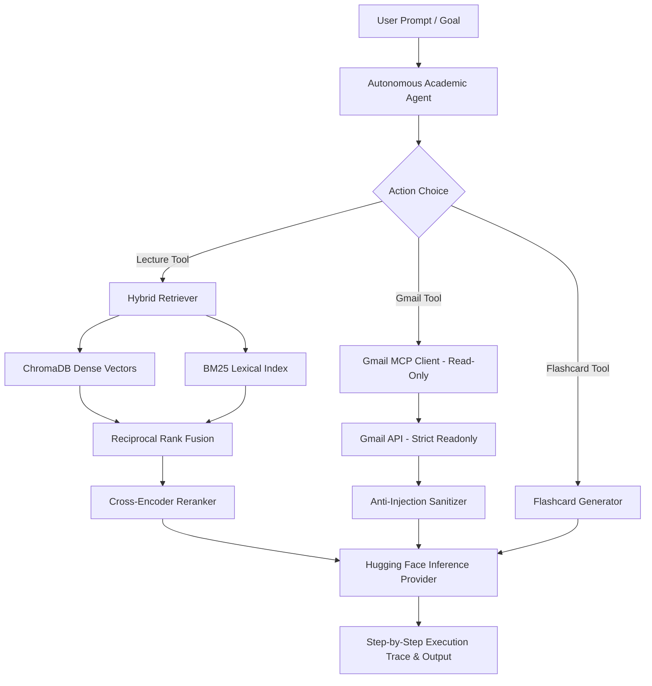

# StudyMatrix RAG — Smart Lecture Summarizer & Autonomous Inbox Agent

A modular AI study application combining Hybrid RAG (Dense ChromaDB + Sparse BM25 + Cross-Encoder reranking) with an autonomous **Model Context Protocol (MCP)** agent for email summarization, assignment tracking, and study synthesis.

Powered by **Hugging Face Inference Providers** (no local Ollama server required):
- Speech transcription: `faster-whisper` with FFmpeg preprocessing
- Dense embeddings: `BAAI/bge-small-en-v1.5` (or configurable via `HF_EMBED_MODEL`)
- Lexical search: `rank-bm25`
- Reranking: `cross-encoder/ms-marco-MiniLM-L-6-v2`
- Chat & Tool-Calling LLM: `Qwen/Qwen2.5-7B-Instruct` (or configurable via `HF_CHAT_MODEL`)
- Email & Task Tool Integration: Model Context Protocol (MCP) with read-only Gmail OAuth

---

## Architecture



---

## Getting Started

### 1. Environment Setup

Open PowerShell or terminal in the project folder:

```powershell
py -3 -m venv .venv
.\.venv\Scripts\Activate.ps1
python -m pip install --upgrade pip
pip install -r requirements.txt
Copy-Item .env.example .env
```

### 2. Configure Hugging Face Token (`HF_TOKEN`)
1. Create a free account at [huggingface.co](https://huggingface.co).
2. Go to **Settings** → **Access Tokens**: [huggingface.co/settings/tokens](https://huggingface.co/settings/tokens).
3. Click **Create new token**, choose type **Read**, and copy the token.
4. Open `.env` and paste your token:
   ```env
   HF_TOKEN=hf_your_token_here
   HF_CHAT_MODEL=Qwen/Qwen2.5-7B-Instruct
   HF_EMBED_MODEL=BAAI/bge-small-en-v1.5
   ```

### 3. Setting Up Gmail MCP (Google OAuth)
1. Go to the [Google Cloud Console](https://console.cloud.google.com/).
2. Create a new project (e.g. `StudyMatrix-Assistant`).
3. Under **APIs & Services** → **Library**, search for and enable the **Gmail API**.
4. Under **APIs & Services** → **OAuth consent screen**:
   * User Type: **External**
   * Add your Google account as a **Test User**.
5. Under **APIs & Services** → **Credentials**:
   * Click **Create Credentials** → **OAuth Client ID**.
   * Application type: **Desktop app**.
   * Download the JSON file and save it in the project root directory as **`credentials.json`**.
6. On the first run of the Inbox Agent, StudyMatrix will open a browser window for a one-time consent approval requesting strictly read-only scopes (`gmail.readonly`). Tokens are cached locally in `token.json` (protected by `.gitignore`).

---

## Running the Application

### Option A: Streamlit All-in-One Dashboard
```powershell
streamlit run app.py
```
Streamlit discovers the 8 interactive pages:
1. **Upload and Process**: Transcribe and index video, audio, PDFs, and YouTube links.
2. **Lecture Player**: Jump to timestamps, inspect transcripts, and read hierarchical summaries.
3. **Quiz**: Generate adaptive MCQ, True/False, Fill-in, and Open-ended questions.
4. **Ask Lecture Q&A**: Grounded Q&A with verifiable timestamp citations.
5. **Concept Graph**: Interactive NetworkX knowledge graph.
6. **Export**: Export summaries and quizzes to Markdown, PDF, CSV, and Anki decks.
7. **Evaluation**: RAGAS evaluation (faithfulness, context precision, context recall).
8. **Inbox Agent**: Autonomous agent connecting Gmail and lecture notes with step-by-step traces.

### Option B: FastAPI Backend + React Frontend
To run the REST & Streaming API for the React frontend:
```powershell
py server.py
```
FastAPI runs at `http://localhost:8000`:
- `POST /agent/run` & `POST /agent/run/stream`: Execute agent goals.
- `GET /agent/tools`: View exposed tool definitions.
- `GET /agent/status`: View connection health for HF and Gmail.
- `GET /lectures`: View indexed lecture repository.

---

## Re-indexing Collections
If you change your embedding model (`HF_EMBED_MODEL` in `.env`), run the re-indexing script to regenerate dense vector representations in ChromaDB:
```powershell
py scripts/reindex.py
```

---

## Testing
Run the test suite:
```powershell
py -m pytest
```
Testing covers:
- Chunking boundary and overlap logic (`test_chunking.py`)
- Knowledge graph co-occurrence edges (`test_concepts.py`)
- Hugging Face provider abstraction and tool-calling (`test_llm.py`)
- Autonomous Agent ReAct loop and prompt injection escaping (`test_agent.py`)
- Grounded citation validation and RRF fusion (`test_qa.py`, `test_retrieval.py`, `test_summary.py`)

---

## Security & Privacy Rules
- **Untrusted Email Delimiters:** Email text is parsed and wrapped in `<untrusted_email>` blocks. The agent model is instructed to treat all content strictly as passive reference data, preventing prompt injection attacks.
- **Strict Read-Only Scopes:** The application only ever requests `gmail.readonly` permission. It cannot compose, delete, or modify any emails.
- **Zero Secret Commits:** `.gitignore` excludes `.env`, `credentials.json`, `token.json`, and all downloaded video/audio assets.
