# RAG-Based Smart Lecture Summarizer & Adaptive Quiz System

A modular Streamlit application for turning lecture videos, audio, PDFs, PowerPoint files, and YouTube URLs into searchable study material. It uses pretrained models only:

- faster-whisper for timestamped speech transcription
- `BAAI/bge-small-en-v1.5` for dense embeddings
- BM25 plus ChromaDB for hybrid retrieval
- `cross-encoder/ms-marco-MiniLM-L-6-v2` for reranking
- Ollama `llama3` by default for grounded generation

## Architecture

```mermaid
flowchart LR
    A[Upload or YouTube URL] --> B[Ingestion]
    B --> C{Source type}
    C -->|Audio or video| D[FFmpeg + faster-whisper]
    C -->|PDF or PPTX| E[PyMuPDF or python-pptx]
    D --> F[Timestamped transcript]
    E --> G[Slide or page text]
    F --> H[Topic-aware chunking]
    G --> H
    H --> I[Sentence-transformer embeddings]
    H --> J[BM25 tokens]
    I --> K[Persistent ChromaDB]
    J --> L[Hybrid retrieval]
    K --> L
    L --> M[Cross-encoder reranker]
    M --> N[Ollama or OpenAI LLM]
    N --> O[Summary, quiz, Q&A, concepts]
    O --> P[Streamlit pages and exports]
```



## Windows Setup

Open PowerShell in this folder. Python 3.11 or newer, FFmpeg, Ollama, and Git are supported on Windows 11.

```powershell
py -3 -m venv .venv
.\.venv\Scripts\Activate.ps1
python -m pip install --upgrade pip
pip install -r requirements.txt
Copy-Item .env.example .env
```

If PowerShell blocks activation for the current user, run PowerShell once with the following command, then activate again:

```powershell
Set-ExecutionPolicy -Scope CurrentUser RemoteSigned
```

Start Ollama and pull a model:

```powershell
ollama pull llama3
```

For a lower-memory machine, use an installed smaller model in `.env`:

```text
OLLAMA_MODEL=llama3.2:3b
```

The first lecture processing run also downloads the Whisper, embedding, and reranker models from Hugging Face. CPU defaults are Whisper `base` with `int8`; set `WHISPER_DEVICE=auto` to use CUDA when available.

## Run

```powershell
streamlit run app.py
```

Streamlit automatically discovers the pages in `pages/`:

1. **Upload and Process**: upload media, PDF, PPTX, or paste a YouTube URL. Completed sources are cached by SHA-256 fingerprint.
2. **Lecture Player**: play media, jump from transcript timestamps, and generate hierarchical summaries.
3. **Quiz**: create MCQ, true/false, fill-in, and open-ended quizzes with difficulty and Bloom-level controls. Missed concepts are emphasized in the next quiz.
4. **Ask Lecture Q&A**: ask grounded questions and jump from citations to the player.
5. **Concept Graph**: extract concepts, inspect graph relationships, generate a mini-quiz, and ask concept-specific questions.
6. **Export**: download Markdown/PDF summaries and Anki packages. CSV is used when Genanki is unavailable.
7. **Evaluation**: evaluate an uploaded or cached-quiz Q&A set with RAGAS faithfulness, context precision, and context recall.

## Sample Test Flow

For a quick end-to-end test, use a public educational video around five minutes long or a local five-minute `.mp4`/`.mp3`. In **Upload and Process**, paste the URL or upload the file and click **Process lecture**. Wait for transcription, chunking, and indexing to finish. Then open Lecture Player, generate a summary, ask a question in Q&A, and generate a three-question quiz.

The first run may take several minutes because pretrained models are downloaded and loaded. Later runs reuse the local cache under `data/`.

## Configuration

Copy [.env.example](.env.example) to `.env` and adjust:

- `LLM_PROVIDER`: `ollama` or `openai`
- `OLLAMA_BASE_URL`, `OLLAMA_MODEL`: local Ollama endpoint and model
- `OPENAI_API_KEY`, `OPENAI_MODEL`: used only with the OpenAI provider
- `WHISPER_MODEL_SIZE`, `WHISPER_DEVICE`, and compute types
- `EMBEDDING_MODEL` and `RERANKER_MODEL`
- `YTDLP_COOKIES_FROM_BROWSER`: optional browser name such as `chrome` or `edge` for YouTube videos requiring sign-in

Do not commit `.env`, uploaded media, model caches, or generated Chroma data.

If YouTube reports that you are not a bot, close the browser that is signed into YouTube, set `YTDLP_COOKIES_FROM_BROWSER=chrome` or `edge` in `.env`, restart Streamlit, and retry. Some videos cannot be downloaded without browser authentication; a local MP3 or MP4 upload is the reliable fallback.

## Project Layout

```text
app.py                         Streamlit entry point
pages/                         Multipage Streamlit UI
core/                          Reusable ingestion, RAG, LLM, and export services
data/                          Lecture registry, uploads, indexes, and generated artifacts
tests/                         Focused unit and schema tests
requirements.txt               Python dependencies
```

All LLM JSON boundaries use Pydantic validation and retry invalid responses up to three times. Core services do not depend on Streamlit, so they can be wrapped by FastAPI later.

## Tests

Run the complete local test suite:

```powershell
pytest -q
```

The Ollama smoke test is skipped when Ollama or the configured model is unavailable. To run it against a model that is installed locally:

```powershell
$env:OLLAMA_MODEL = "llama3.2:3b"
pytest tests/test_llm.py -q
```

RAGAS evaluation is an optional runtime workflow and requires its dependencies from `requirements.txt` plus a configured evaluation-capable model/provider.
